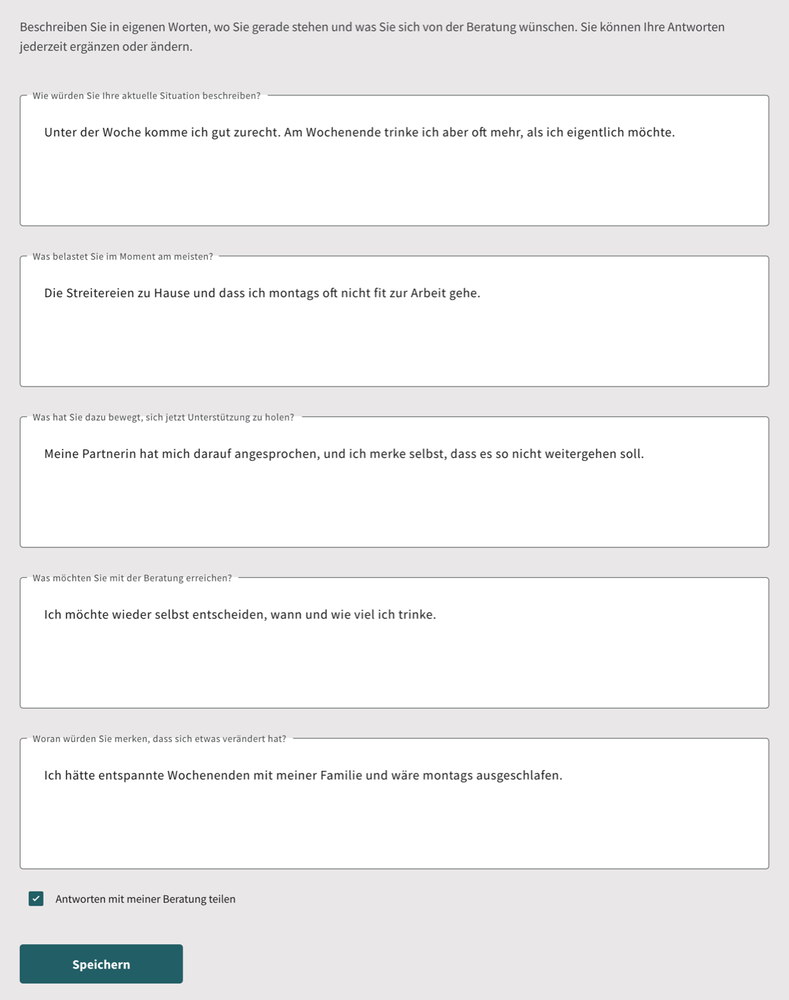

# Ausgangssituation und Ziele

Ein kurzer Fragebogen für den Beginn einer Beratung. Ratsuchende beschreiben in eigenen Worten, wie es ihnen gerade geht, was sie belastet und was sie mit der Beratung erreichen möchten. Die Beratung bekommt so schon vor dem ersten ausführlichen Gespräch ein Bild der Ausgangslage, und beide Seiten können später darauf zurückkommen.

## Ablauf

1. **Freigeben:** Die Beraterin oder der Berater gibt das Tool im Fall frei, in der Seitenleiste der Beratung. Die ratsuchende Person wird benachrichtigt und findet „Ausgangssituation und Ziele“ danach in ihrer Navigation.
2. **Ausfüllen:** Fünf offene Fragen, in der Anrede, die für die Person eingestellt ist (Sie oder du). Antworten lassen sich jederzeit ergänzen und ändern.
3. **Teilen:** Die ratsuchende Person entscheidet selbst, ob die Beratung ihre Antworten sieht. Beim Teilen wird die Beratung im Zeitstrahl benachrichtigt und findet die Antworten im Fall und im Profil der Person.

## Datenschutz

- Die Antworten liegen nur beim Add-on, nicht im Chat und nicht in den ORISO-Diensten.
- Ohne Teilen sieht die Beratung nur den Status (freigegeben, bearbeitet), keine Inhalte.
- Wird ein Konto gelöscht, löscht das Add-on die zugehörigen Antworten mit.
- Neue Freigaben sind nur möglich, wenn der Träger die aktuelle Auftragsverarbeitungsvereinbarung bestätigt hat.

## Einstellungen

Je Träger und je Beratungsstelle:

- **Einleitung:** eigener Text über den Fragen
- **Teilen erlauben:** lässt sich abschalten, wenn Antworten nur für die ratsuchende Person gedacht sind

## Statistik

Anzahl freigegebener, begonnener und geteilter Fragebögen, ohne Bezug zu Personen.
