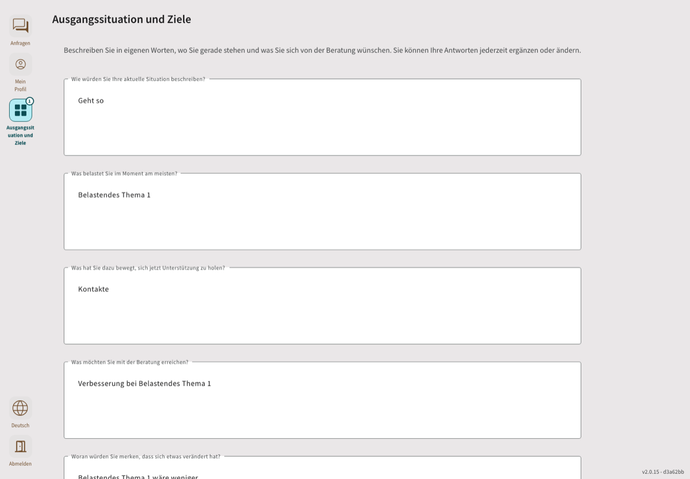
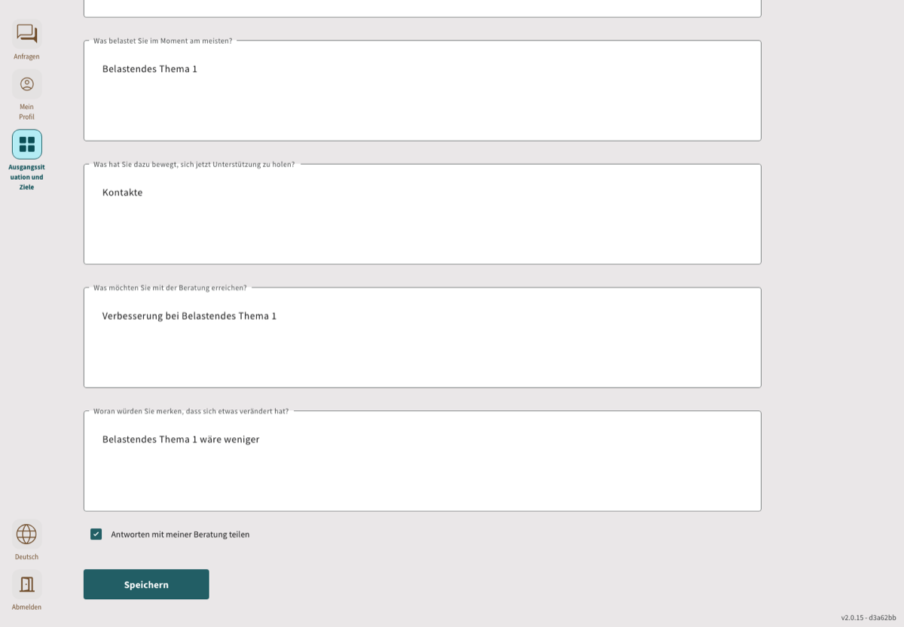

# Ausgangssituation und Ziele

Ratsuchende beschreiben zu Beginn der Beratung in eigenen Worten, wo sie stehen und was sie erreichen möchten. Die Beratung schaltet das Tool im Fall frei; die ratsuchende Person entscheidet selbst, ob sie ihre Antworten teilt.

**So funktioniert es**

- Die Beraterin oder der Berater gibt das Tool im Fall frei. Die ratsuchende Person wird benachrichtigt und findet es in ihrer Navigation.
- Fünf offene Fragen, jederzeit änderbar. Gespeichert wird nur beim Add-on, nicht im Chat.
- Geteilte Antworten erscheinen im Fall in der Seitenleiste; die Beratung wird im Zeitstrahl benachrichtigt.

**Einstellungen**

- Eigener Einleitungstext je Träger oder Beratungsstelle
- Teilen erlauben oder abschalten

**Statistik:** freigegebene, begonnene und geteilte Tools.
